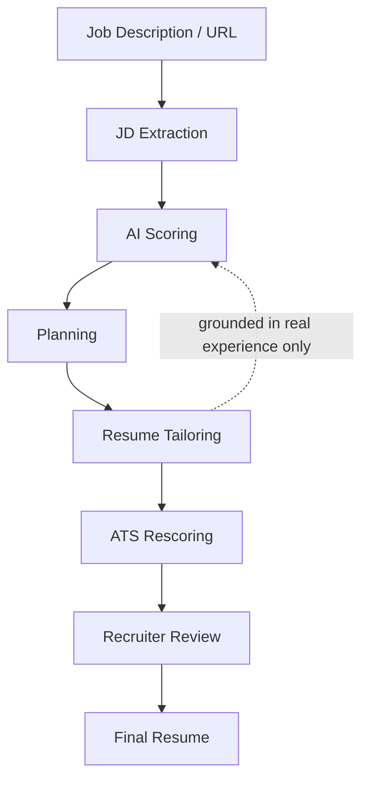

# Eleva — AI Career Operating System

> **Multi-stage resume optimization and ATS scoring pipeline** — paste a job description, and Eleva scores your resume, tailors it with honest-AI constraints, shows you the diff, and tracks the application.

**Live demo** → [eleva-beige.vercel.app/eleva](https://eleva-beige.vercel.app/eleva) · Blog post: [how the scoring works](https://ashish-chandan.vercel.app/blog/building-elevas-ats-pipeline)

## Why it exists

Job-search tooling either keyword-stuffs your resume or hands you a generic "AI rewrite" that fabricates experience. Eleva is built around a multi-stage pipeline that rewrites only what your real experience supports — and proves it with a structured ATS-style analysis.

## Architecture



## Key features

- **ATS parser simulation** — weighted keyword, formatting, and recruiter-signal analysis, not a keyword-count blender.
- **Multi-stage tailoring workflow** — paste JD → match analysis → tailored resume → review diff → apply & track.
- **Honest AI constraints** — rewrites restructure and re-emphasize *supported* facts only. Employers, titles, projects, degrees, and metrics must exist in the resume. Nothing is invented.
- **Provider-agnostic LLM routing** — requests route across providers with automatic fallback; rate limits fail over instead of failing the workflow.
- **Application kanban** — every application tracked from first touch to offer/rejection.

## Measured results

| Metric | Value |
| --- | --- |
| ATS score lift | 61 → 91 on the same resume |
| Keyword gaps fixed | 4 |
| Facts fabricated | 0 |
| Provider failover paths | 3× |

[Eval artifact](https://ashish-chandan.vercel.app/eleva-ats-eval.json) · methodology in the [scoring post](https://ashish-chandan.vercel.app/blog/building-elevas-ats-pipeline)

- ✅ Authentication — Supabase Auth (Google OAuth + email) with SSR session handling
- ✅ Row Level Security — per-user data isolation on every table
- ✅ Validation — Zod schemas on all API inputs and AI outputs
- ✅ Standardized API Errors — consistent `{ success, code, message, requestId }` envelope
- ✅ Retry Logic — exponential backoff + `Retry-After` support across providers
- ✅ Rate Limiting — leaky-bucket via Redis (Upstash or local)
- ✅ Caching — AI response cache layer
- ✅ Monitoring — Sentry error tracking + PostHog analytics + OpenTelemetry spans
- ✅ Structured Logging — dependency-free JSON logger with request context and credential redaction
- ✅ Health Endpoint — `GET /api/health` (database + env checks)
- ✅ Audit Logging — `activity_log` for key user actions
- ✅ Startup Env Validation — fails fast on missing configuration
- ✅ Tests — Vitest behavior tests with a 75.2/85/82.5/75.2 global coverage ratchet, axe checks, and Playwright smoke tests
- ✅ CI/CD — lint, architecture, source-size, test, coverage, browser, Lighthouse, bundle, dependency, Helm, and Terraform checks
- ✅ Security — CodeQL, full-history gitleaks scanning, SPDX SBOM artifacts, OpenSSF Scorecard, image vulnerability scans, and a documented threat model
- ✅ Infrastructure as Code — Terraform modules for Vercel and Upstash Redis with plan/policy scanning
- ✅ Deployment — Vercel, multi-stage Docker image, Helm charts

## Tech stack

- **Frontend** — Next.js, TypeScript, React, Tailwind CSS
- **Backend** — Next.js API routes, Supabase (auth, storage, Postgres)
- **AI** — LLM APIs with provider routing + fallback
- **Deployment** — Vercel

## Getting started

```bash
git clone https://github.com/chandu954/Eleva
cd Eleva
pnpm install
cp .env.example .env.local   # Supabase + LLM provider keys
pnpm dev
```

Visit [http://localhost:3000](http://localhost:3000).

### Dev container

The repo ships a [dev container](.devcontainer/devcontainer.json) backed by
the same `docker-compose.yml` as the local stack (Node 22, Supabase, Redis),
with Playwright/Vitest/Terraform editor integrations. Open the folder in VS
Code → **Reopen in Container**, then run `pnpm dev`. Ports 3000 (app) and 4000
(Playwright) are forwarded automatically.

### Testing & Quality Gates

```bash
pnpm lint       # ESLint
pnpm typecheck  # tsc --noEmit (strict mode)
pnpm test       # Vitest unit/component suite (jsdom, Testing Library)
pnpm coverage   # Tests + enforced coverage thresholds (ratchet policy)
pnpm test:e2e   # Playwright smoke tests (Chromium)
pnpm test:mutation # Manual Stryker run for pipeline/cache and rate-limit code
pnpm build      # Next.js production build
pnpm check:source-loc  # Enforce the 500 LOC production TypeScript file limit
pnpm check:bundles     # Check compressed route bundles after a production build
pnpm check:dead-code   # Enforce the current production file/dependency debt ceiling
pnpm check:duplication # Block clones that are absent from the checked-in baseline
pnpm report:dependency-health # Refresh docs/DEPENDENCIES.md with resolved/transitive counts
```

The global coverage floors are 75.2% statements, 85% branches, 82.5% functions,
and 75.2% lines. Files under `src/lib/` have separate floors of 60/83/79/60.
The CI quality job also checks dependency cycles, the production source-size
limit, unused production files/dependencies against a fixed issue ceiling, and
new production-code clones against the checked-in jscpd baseline.
The dependency-health report records the real supply-chain surface from the
checked-in lockfile: 76 direct runtime deps, 34 direct dev deps, 1,502 resolved
packages, and `total_transitive_deps` = 1,392. Refresh it with
`pnpm report:dependency-health`; the numbers mirror
[`docs/DEPENDENCIES.md`](docs/DEPENDENCIES.md).
The manual targeted mutation baseline is 73.71%; its scope and limitations are
recorded in [the mutation-testing notes](docs/testing/mutation-testing.md).

The unit suite uses the deterministic mock AI provider and stubs
Supabase/PostgREST under `src/test/`. Vitest blocks unmocked global `fetch`
calls; use the documented macOS sandbox command for process-wide network
isolation. The Playwright suite also runs without secrets —
`playwright.config.ts` points
Supabase at a closed local port and forces the mock AI provider, so the smoke
tests only exercise public routing, login redirects, and the health endpoint.

CI (`.github/workflows/ci.yml`) runs five jobs on every PR and push to `main`:
**quality** (lint, typecheck, unit tests, coverage thresholds), **e2e**
(Playwright smoke suite), **audit** (`pnpm audit --audit-level=high` with
documented exemptions), **infrastructure** (Helm lint, rendered-manifest
validation, Hadolint, and advisory Checkov findings), and **terraform** (fmt,
validate, TFLint, and blocking Checkov). E2E also checks axe violations on
public pages and authenticated dashboard/editor pages when credentials are
configured, with landing and editor visual snapshots. Lighthouse budgets
(performance ≥90, LCP <2.5s, CLS <0.1), and compressed first-load bundles
(500 KiB for `/resumes/[id]`, 400 KiB for `/home` and `/eleva/resumes`).

Separate CodeQL, security, and Scorecard workflows scan code, image, and
repository posture and upload an SPDX source SBOM. Docker publishing scans
each platform image digest, emits BuildKit provenance, and signs published
tags keylessly with Cosign. Every GitHub Action reference is pinned to a full
commit SHA with its release tag noted in the workflow. Terraform apply and
drift workflows use protected GitHub environments and an S3 remote state
backend; enabling them requires the bucket, environment variables, and
cloud/provider secrets described in [terraform/README.md](terraform/README.md).
Conventions and the coverage-ratchet rule live in
[CONTRIBUTING.md](CONTRIBUTING.md).

### Database Setup

1. Open your Supabase project's SQL Editor.
2. Run all migration files from `supabase/migrations/` in order.
3. Enable the required Storage buckets (`resumes`, `avatars`, `exports`).

## AI Providers

Eleva supports six AI providers. Set the corresponding environment variable for each provider you want to use:

| Provider | Env Variable | Model Examples |
|----------|-------------|---------------|
| OpenAI | `OPENAI_API_KEY` | GPT-4.1, GPT-4o Mini |
| Anthropic | `ANTHROPIC_API_KEY` | Claude Sonnet 4, Claude 3.5 |
| Google Gemini | `GEMINI_API_KEY` | Gemini 2.5 Pro, Gemini 2.5 Flash |
| OpenRouter | `OPENROUTER_API_KEY` | 300+ models through one API |
| NVIDIA | `NVIDIA_API_KEY` | Nemotron, Llama on NVIDIA API |
| Ollama | (none, local) | Any self-hosted model |

The default provider is configurable via `DEFAULT_AI_PROVIDER` env variable (JSON format).

## API Overview

| Endpoint | Description |
|----------|-------------|
| `GET /api/health` | Liveness probe — database + environment checks |
| `POST /api/chat` | Streaming AI chat with tool access to resume data |
| `POST /eleva/api/studio/pipeline` | Full pipeline: ATS score → tailor → cover letter |
| `POST /eleva/api/resumes/import` | Parse and import a resume |
| `POST /eleva/api/applications` | Create/update/delete tracked applications |
| `POST /eleva/api/export/resume` | Export resume as PDF |
| `POST /eleva/api/export/resume-docx` | Export resume as DOCX |

All API errors use a consistent envelope:

```json
{
  "success": false,
  "code": "RATE_LIMIT_EXCEEDED",
  "message": "Rate limit exceeded.",
  "requestId": "m3x8f0-1f-a1b2c3"
}
```

## Observability

Server code logs through `src/lib/logger.ts`, a dependency-free JSON logger
that works in both the Node.js and Edge runtimes. Every line is one JSON
object, so log drains can index fields without regex parsing:

```json
{"timestamp":"2026-10-27T13:44:10.740Z","level":"warn","service":"eleva","environment":"production","message":"pipeline.section.fallback","section":"summary","requestId":"m3x8f0-1f-a1b2c3"}
```

- `LOG_LEVEL` controls verbosity (`debug`, `info`, `warn`, `error`; default `info`).
- `logger.child({ requestId })` binds per-request context.
- Credential-shaped keys (`authorization`, `apiKey`, `password`, `token`, …)
  are redacted at any nesting depth, and `Error` objects keep their stack.
- Sentry captures unhandled errors; the structured log line is the searchable
  audit trail around them.

## Infrastructure as Code

Production infrastructure is managed with Terraform under `terraform/`:

```
terraform/
├── modules/
│   ├── vercel-project/   # Vercel project, git link, env vars, custom domain
│   └── upstash-redis/    # Upstash Redis database for rate limiting
└── envs/
    └── production/       # Composition, lockfile, example tfvars
```

```bash
cd terraform/envs/production
cp terraform.tfvars.example terraform.tfvars   # fill in real values
terraform init
terraform plan
terraform apply
```

The provider lockfile is committed for reproducible installs. CI enforces
`terraform fmt -check`, `terraform validate`, TFLint, and a Checkov policy
scan; a read-only `terraform plan` runs only when provider credentials are
configured as repository secrets. See [terraform/README.md](terraform/README.md)
for bootstrap and remote-state guidance.

See [architecture](docs/ARCHITECTURE.md), the [HTTP API reference](docs/API.md),
the [operations runbook](docs/operations/runbook.md), and
[architecture decision records](docs/adr/) for implementation and operations
details.

## Deployment

### Vercel

[](https://vercel.com/new)

Deploy the Next.js app directly with all required environment variables set in the Vercel dashboard, or provision the project and its environment through the Terraform stack in `terraform/envs/production`.

### Docker

```bash
docker build -f Dockerfile -t eleva:latest .
docker compose up
```

### Kubernetes (Helm)

```bash
helm install eleva ./helm/resumelm -f your-values.yaml
```

See [SETUP.md](SETUP.md) and `docker/DOCKER.md` for detailed deployment instructions.

## Project Structure

```
src/
├── app/                    # Next.js App Router pages
│   ├── (dashboard)/       # Protected dashboard routes
│   ├── api/               # API routes (chat, webhooks, health)
│   ├── auth/              # Authentication pages
│   ├── blog/              # MDX blog
│   └── eleva/             # Main Eleva workspace
├── components/            # React components
│   ├── resume/            # Resume editor, management, AI assistant
│   ├── landing/           # Marketing pages
│   ├── settings/          # User settings forms
│   ├── ui/                # shadcn/ui primitives
│   └── shared/            # Shared components
├── lib/                   # Core logic
│   ├── ai/                # AI provider abstraction (router, factory, models)
│   ├── stripe/            # Stripe integration
│   ├── analytics/         # PostHog analytics
│   └── supabase/          # Supabase clients
├── hooks/                 # Custom React hooks
├── test/                  # Shared Vitest setup and stubs
├── e2e/                   # Playwright smoke specs (*.e2e.test.ts)
└── utils/                 # Server actions and utilities

terraform/                 # Vercel + Upstash infrastructure as code
helm/                      # Kubernetes chart
```

## Environment Variables

All environment variables are documented in `.env.example`. Key variables:

- `OPENAI_API_KEY` / `ANTHROPIC_API_KEY` / `OPENROUTER_API_KEY` — AI provider keys
- `NEXT_PUBLIC_SUPABASE_URL` / `NEXT_PUBLIC_SUPABASE_ANON_KEY` — Supabase config
- `SUPABASE_SERVICE_ROLE_KEY` — Server-side database access
- `STRIPE_SECRET_KEY` / `STRIPE_WEBHOOK_SECRET` — Payment processing
- `PROVIDER_KEY_ENCRYPTION_SECRET` — Encryption for user BYOK feature

## Security

See [SECURITY.md](SECURITY.md) for the security model, supported versions, and
private vulnerability reporting. In short: never commit `.env*` values, all
user data is scoped by Supabase RLS, Stripe webhooks verify signatures, and CI
blocks high/critical dependency advisories plus credential-shaped strings in
tracked files. The repository also runs CodeQL and gitleaks, uploads an SPDX
SBOM, and documents trust boundaries and residual risks in the
[threat model](docs/security/threat-model.md). Docker uses a digest-pinned Node
base image; advance it through reviewed Dependabot updates.

## Roadmap

- [ ] LLM-as-judge eval harness for fabrication rate
- [ ] PDF resume upload (parse real layouts)
- [ ] Job tracker sync with email/linkedin exports
