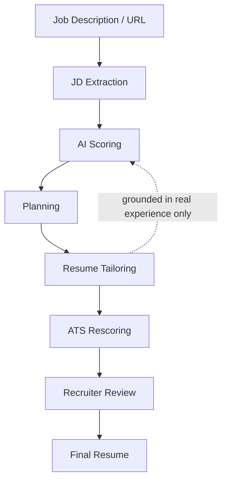

# Eleva — AI Career Operating System

> **Multi-stage resume optimization and ATS scoring pipeline** — paste a job description, and Eleva scores your resume, tailors it with honest-AI constraints, shows you the diff, and tracks the application.

**Live demo** → [eleva-beige.vercel.app/eleva](https://eleva-beige.vercel.app/eleva) · Blog post: [how the scoring works](https://ashish-chandan.vercel.app/blog/building-elevas-ats-pipeline)

## Why it exists

Job-search tooling either keyword-stuffs your resume or hands you a generic "AI rewrite" that fabricates experience. Eleva is built around a multi-stage pipeline that rewrites only what your real experience supports — and proves it with a structured ATS-style analysis.

## Architecture



## Key features

- **ATS parser simulation** — weighted keyword, formatting, and recruiter-signal analysis, not a keyword-count blender.
- **Multi-stage tailoring workflow** — paste JD → match analysis → tailored resume → review diff → apply & track.
- **Honest AI constraints** — rewrites restructure and re-emphasize *supported* facts only. Employers, titles, projects, degrees, and metrics must exist in the resume. Nothing is invented.
- **Provider-agnostic LLM routing** — requests route across providers with automatic fallback; rate limits fail over instead of failing the workflow.
- **Application kanban** — every application tracked from first touch to offer/rejection.

## Measured results

| Metric | Value |
| --- | --- |
| ATS score lift | 61 → 91 on the same resume |
| Keyword gaps fixed | 4 |
| Facts fabricated | 0 |
| Provider failover paths | 3× |

[Eval artifact](https://ashish-chandan.vercel.app/eleva-ats-eval.json) · methodology in the [scoring post](https://ashish-chandan.vercel.app/blog/building-elevas-ats-pipeline)

- ✅ Authentication — Supabase Auth (Google OAuth + email) with SSR session handling
- ✅ Row Level Security — per-user data isolation on every table
- ✅ Validation — Zod schemas on all API inputs and AI outputs
- ✅ Standardized API Errors — consistent `{ success, code, message, requestId }` envelope
- ✅ Retry Logic — exponential backoff + `Retry-After` support across providers
- ✅ Rate Limiting — leaky-bucket via Redis (Upstash or local)
- ✅ Caching — AI response cache layer
- ✅ Monitoring — Sentry error tracking + PostHog analytics + OpenTelemetry spans
- ✅ Health Endpoint — `GET /api/health` (database + env checks)
- ✅ Audit Logging — `activity_log` for key user actions
- ✅ Startup Env Validation — fails fast on missing configuration
- ✅ Tests — Vitest unit + component tests with enforced coverage thresholds + Playwright e2e
- ✅ CI/CD — GitHub Actions quality gate (lint, typecheck, tests, coverage) + dependency audit + Docker/Helm publish
- ✅ Deployment — Vercel, multi-stage Docker image, Helm charts

## Tech stack

- **Frontend** — Next.js, TypeScript, React, Tailwind CSS
- **Backend** — Next.js API routes, Supabase (auth, storage, Postgres)
- **AI** — LLM APIs with provider routing + fallback
- **Deployment** — Vercel

## Getting started

```bash
git clone https://github.com/chandu954/Eleva
cd Eleva
pnpm install
cp .env.example .env.local   # Supabase + LLM provider keys
pnpm dev
```

Visit [http://localhost:3000](http://localhost:3000).

### Testing & Quality Gates

```bash
pnpm lint       # ESLint
pnpm typecheck  # tsc --noEmit (strict mode)
pnpm test       # Vitest unit suite (jsdom, Testing Library)
pnpm coverage   # Tests + enforced coverage thresholds (ratchet policy)
pnpm build      # Next.js production build
```

CI (`.github/workflows/ci.yml`) runs two jobs on every PR and push to
`main`: **quality** (lint, typecheck, unit tests, coverage thresholds)
and **audit** (`pnpm audit --audit-level=high` with documented
exemptions). Conventions and the coverage-ratchet rule live in
[CONTRIBUTING.md](CONTRIBUTING.md).

### Database Setup

1. Open your Supabase project's SQL Editor.
2. Run all migration files from `supabase/migrations/` in order.
3. Enable the required Storage buckets (`resumes`, `avatars`, `exports`).

## AI Providers

Eleva supports six AI providers. Set the corresponding environment variable for each provider you want to use:

| Provider | Env Variable | Model Examples |
|----------|-------------|---------------|
| OpenAI | `OPENAI_API_KEY` | GPT-4.1, GPT-4o Mini |
| Anthropic | `ANTHROPIC_API_KEY` | Claude Sonnet 4, Claude 3.5 |
| Google Gemini | `GEMINI_API_KEY` | Gemini 2.5 Pro, Gemini 2.5 Flash |
| OpenRouter | `OPENROUTER_API_KEY` | 300+ models through one API |
| NVIDIA | `NVIDIA_API_KEY` | Nemotron, Llama on NVIDIA API |
| Ollama | (none, local) | Any self-hosted model |

The default provider is configurable via `DEFAULT_AI_PROVIDER` env variable (JSON format).

## API Overview

| Endpoint | Description |
|----------|-------------|
| `GET /api/health` | Liveness probe — database + environment checks |
| `POST /api/chat` | Streaming AI chat with tool access to resume data |
| `POST /eleva/api/studio/pipeline` | Full pipeline: ATS score → tailor → cover letter |
| `POST /eleva/api/resumes/import` | Parse and import a resume |
| `POST /eleva/api/applications` | Create/update/delete tracked applications |
| `POST /eleva/api/export/resume` | Export resume as PDF |
| `POST /eleva/api/export/resume-docx` | Export resume as DOCX |

All API errors use a consistent envelope:

```json
{
  "success": false,
  "code": "RATE_LIMIT_EXCEEDED",
  "message": "Rate limit exceeded.",
  "requestId": "m3x8f0-1f-a1b2c3"
}
```

## Deployment

### Vercel

[](https://vercel.com/new)

Deploy the Next.js app directly with all required environment variables set in the Vercel dashboard.

### Docker

```bash
docker build -f Dockerfile -t eleva:latest .
docker compose up
```

### Kubernetes (Helm)

```bash
helm install eleva ./helm/resumelm -f your-values.yaml
```

See [SETUP.md](SETUP.md) and `docker/DOCKER.md` for detailed deployment instructions.

## Project Structure

```
src/
├── app/                    # Next.js App Router pages
│   ├── (dashboard)/       # Protected dashboard routes
│   ├── api/               # API routes (chat, webhooks, health)
│   ├── auth/              # Authentication pages
│   ├── blog/              # MDX blog
│   └── eleva/             # Main Eleva workspace
├── components/            # React components
│   ├── resume/            # Resume editor, management, AI assistant
│   ├── landing/           # Marketing pages
│   ├── settings/          # User settings forms
│   ├── ui/                # shadcn/ui primitives
│   └── shared/            # Shared components
├── lib/                   # Core logic
│   ├── ai/                # AI provider abstraction (router, factory, models)
│   ├── stripe/            # Stripe integration
│   ├── analytics/         # PostHog analytics
│   └── supabase/          # Supabase clients
├── hooks/                 # Custom React hooks
└── utils/                 # Server actions and utilities
```

## Environment Variables

All environment variables are documented in `.env.example`. Key variables:

- `OPENAI_API_KEY` / `ANTHROPIC_API_KEY` / `OPENROUTER_API_KEY` — AI provider keys
- `NEXT_PUBLIC_SUPABASE_URL` / `NEXT_PUBLIC_SUPABASE_ANON_KEY` — Supabase config
- `SUPABASE_SERVICE_ROLE_KEY` — Server-side database access
- `STRIPE_SECRET_KEY` / `STRIPE_WEBHOOK_SECRET` — Payment processing
- `PROVIDER_KEY_ENCRYPTION_SECRET` — Encryption for user BYOK feature

## Roadmap

- [ ] LLM-as-judge eval harness for fabrication rate
- [ ] PDF resume upload (parse real layouts)
- [ ] Job tracker sync with email/linkedin exports