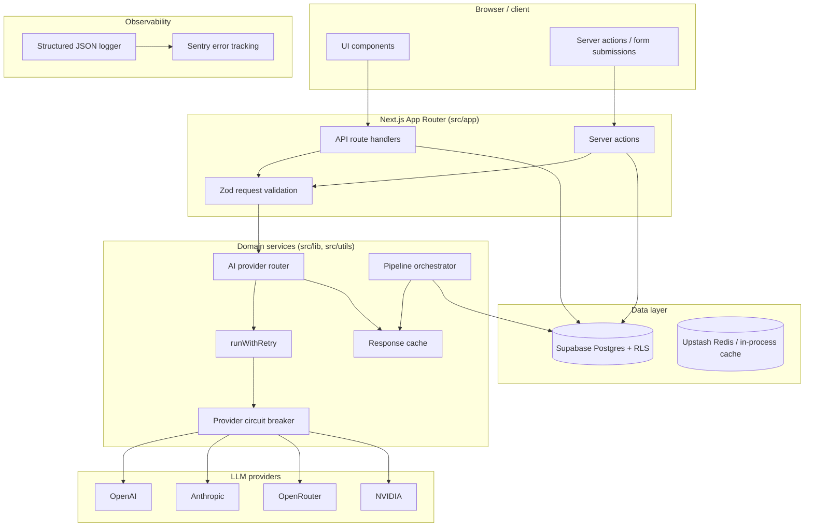
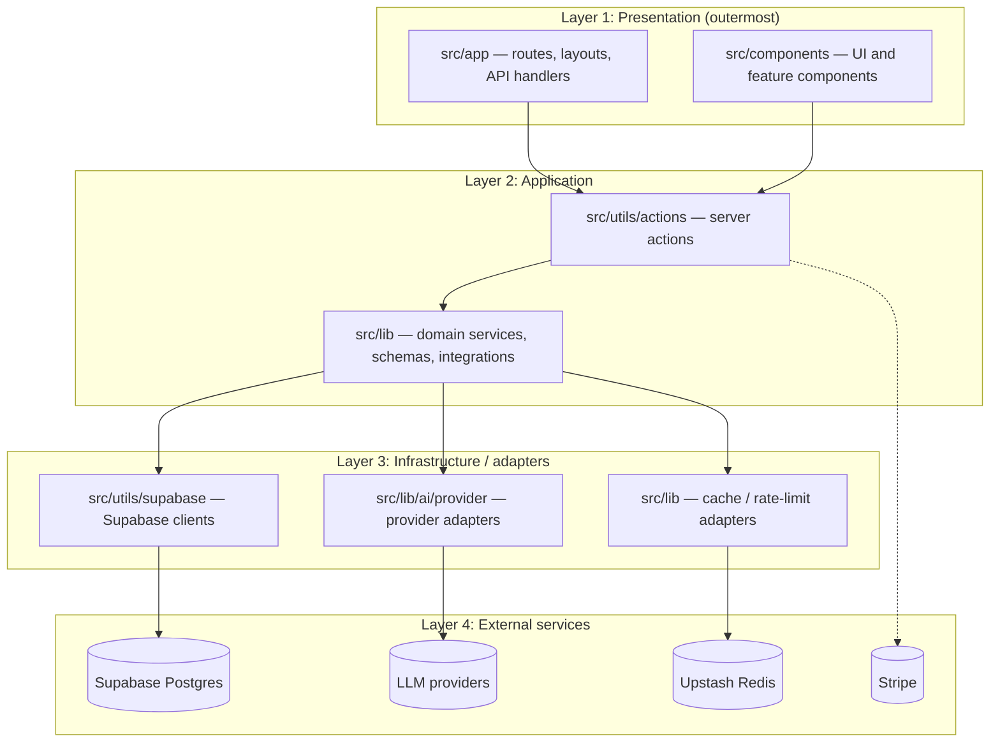

# Architecture diagrams

This document contains the module-boundary and data-flow diagrams for Eleva. It complements
`docs/ARCHITECTURE.md` (textual layout) and the ADRs under `docs/adr/`.

## 1. Request data flow (AI-backed operations)



### Flow notes
- Every AI request is validated with Zod before reaching the provider router (`docs/adr/0001-ai-provider-router.md`).
- Provider selection and fallback policy live in the shared router, not in UI components or individual actions.
- Provider SDKs and fetch adapters enforce a 120-second request timeout.
- Errors are recorded through the structured JSON logger and reported to Sentry; provider credentials never leave the server.

## 2. Stripe billing / webhook data flow

```mermaid
flowchart TD
    subgraph Stripe ["Stripe (external)"]
        Checkout[Checkout / portal sessions]
        WH[Webhook events]
    end

    subgraph App ["Next.js App Router"]
        Srv[Server-side session creation]
        WHRoute[Stripe webhook route handler]
    end

    subgraph Domain ["Domain services"]
        Ledger[Webhook event ledger (idempotency)]
        State[Subscription state]
    end

    subgraph Data ["Data layer"]
        SB[(Supabase Postgres + RLS)]
    end

    Checkout --> Srv
    Srv --> SB
    WH --> WHRoute
    WHRoute --> Ledger
    Ledger --> State
    State --> SB
```

### Flow notes
- Checkout and portal sessions are created server-side; clients never supply plan values for access checks.
- Verified Stripe webhooks are the authoritative subscription lifecycle signal.
- Webhook processing is idempotent via the event ledger; duplicate deliveries are safe (`docs/adr/0003-billing-and-stripe-events.md`).

## 3. Module boundaries and dependency direction



### Dependency rule
Dependencies flow inward only: presentation → application → infrastructure → external. Cycles are blocked by `.dependency-cruiser.cjs`, enforced in CI via `pnpm check:architecture`.
